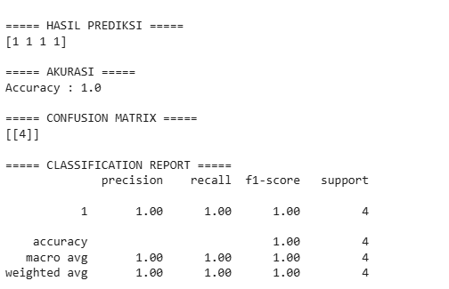
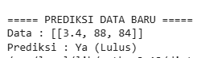
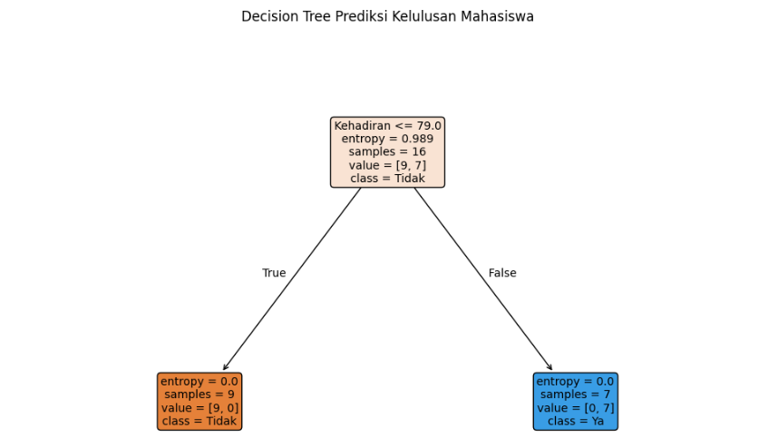

# Student Graduation Prediction

A machine learning project to predict student graduation status using the Decision Tree classification algorithm.

## Overview

This project implements a Decision Tree model to classify student graduation status based on academic performance data.

The model uses three features:

- **IPK (GPA):** Student grade point average.
- **Kehadiran (Attendance):** Student attendance.
- **Tugas (Assignment):** Student assignment score.

The target variable is **Lulus**, consisting of two classes: `Ya` and `Tidak`.

## Dataset

The dataset contains student academic records with four columns:

| Column | Description |
|---|---|
| IPK | Student GPA |
| Kehadiran | Student attendance |
| Tugas | Student assignment score |
| Lulus | Graduation status |

Dataset file: `Soal pertemuan 10 - Sheet1.csv`

## Technologies Used

- Python
- Pandas
- Scikit-learn
- Matplotlib

## Machine Learning Workflow

1. Load the dataset using Pandas.
2. Encode graduation labels using Label Encoder.
3. Separate features and target variables.
4. Split the dataset into training and testing sets (80:20).
5. Train the Decision Tree classifier using the Entropy criterion.
6. Evaluate the model using:
   - Accuracy Score
   - Confusion Matrix
   - Classification Report
7. Visualize the Decision Tree.
8. Perform predictions on new student data.

## Project Structure

```text
student-graduation-prediction/
│
├── README.md
├── decisiontree.py
├── requirements.txt
├── Soal pertemuan 10 - Sheet1.csv
│
└── outputs/
    ├── decision-tree.png
    ├── model-evaluation.png
    └── new-predictions.png
```

## Results & Visualization

### 1. Model Evaluation

The model evaluation includes accuracy, confusion matrix, and classification report.



### 2. New Student Prediction

The model is tested using new student data based on GPA, attendance, and assignment scores.



### 3. Decision Tree Visualization

The following image displays the trained Decision Tree model and its decision-making structure.



## Example Prediction

The program tests two sample student records:

| IPK | Kehadiran | Tugas |
|---:|---:|---:|
| 3.4 | 88 | 84 |
| 2.2 | 60 | 55 |

The model generates graduation predictions based on the trained Decision Tree classifier.

## Installation

Install the required libraries:

```bash
pip install -r requirements.txt
```

## How to Run

Make sure the dataset is in the same directory as the Python script.

Run the program:

```bash
python decisiontree.py
```

## Author

**Rahma Anjani**

Informatics Student | Aspiring Software Developer
